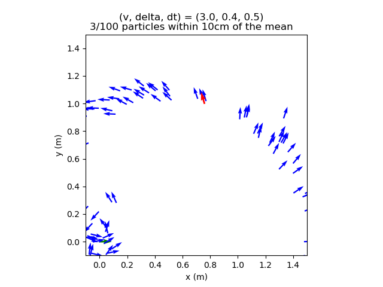
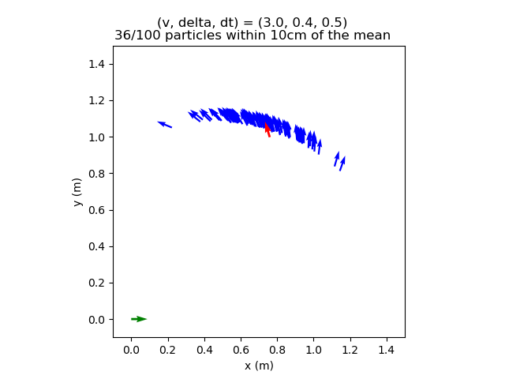
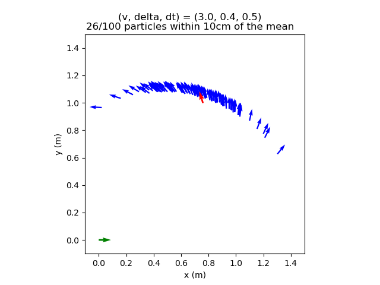
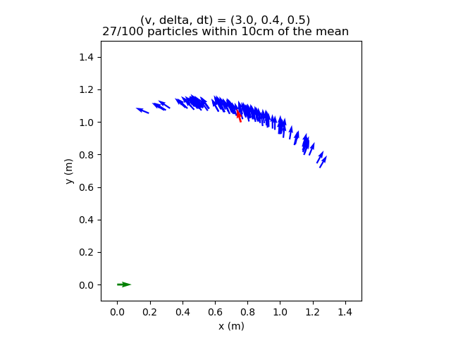
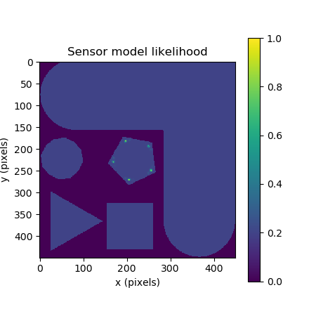

# Project 2: Localization 

1 - There are more partibles within the 10cm readius of the noise-free model because without any variance created by the noise the model will be significanly more consistent in the final result. This does not mean that the value will be correct, as the model with noise is likely closer to a real example and will likely be closer to what we can see when running the actual car.

2 - 

  
mm1 - default values

  
mm2 - lower noise values by 10x - make tighter groupings

  
mm3 - increase delta error - make more banana shape

  
mm4 - increase x and y error - increase sparsity of particle positions

3 -

4 - 

  
  
  
  
